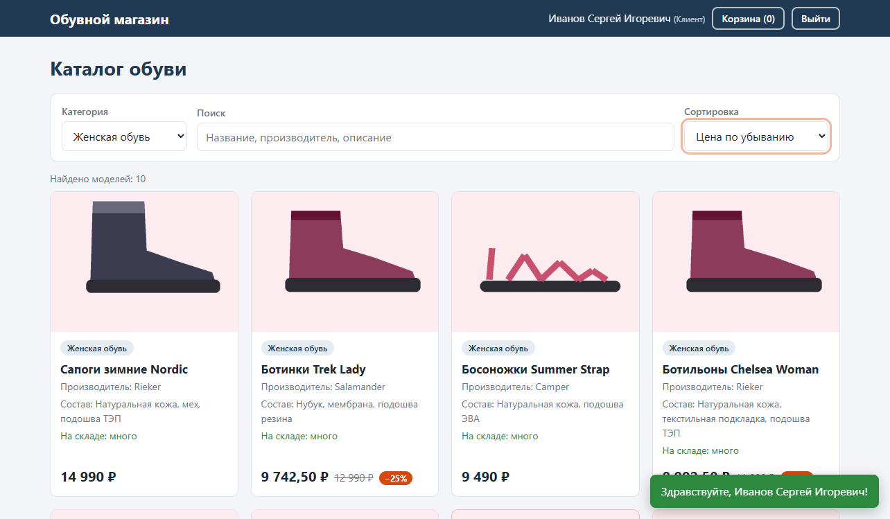
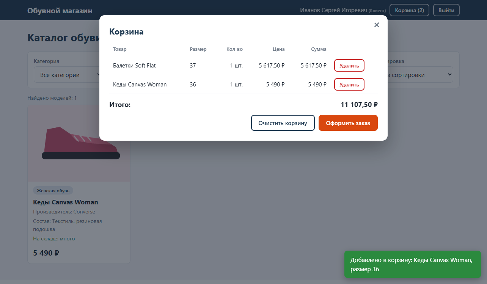
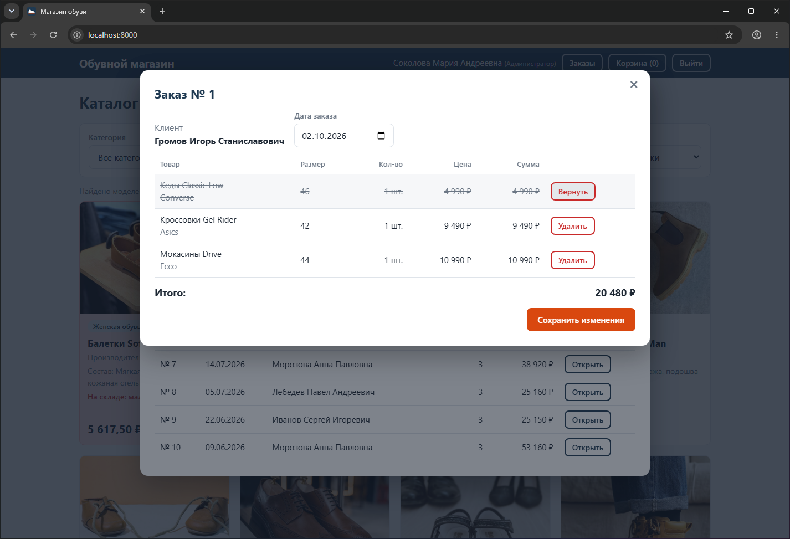
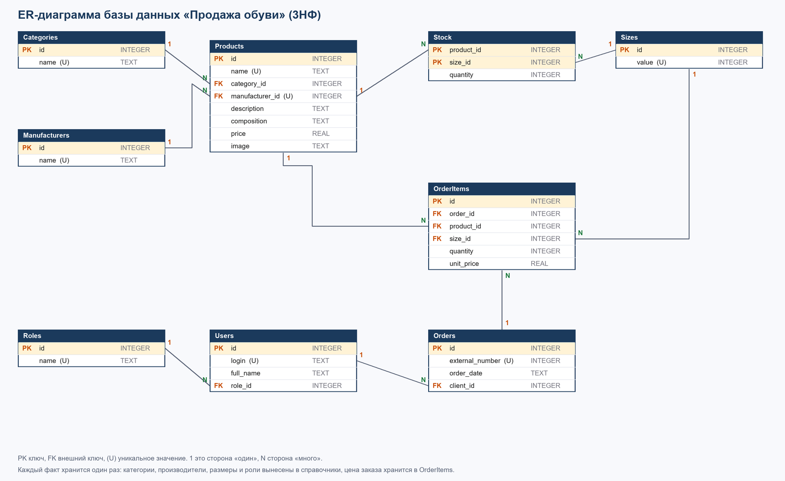

# Магазин обуви

Учебный проект по МДК 04.01 «Внедрение и поддержка компьютерных систем». Это система для компании по продаже обуви: база данных с товарами, остатками и заказами, сервер с API и веб-страница, через которую клиент выбирает обувь и оформляет заказ, а менеджер и администратор работают с заказами.

Выполнил Маматисаков Элмурат, группа 4ИСП9-45.

## Технологии

- Python 3 (только встроенные модули: `http.server`, `sqlite3`, `zipfile`, `json`, `logging`)
- SQLite
- JavaScript без библиотек (одна страница: `index.html`, `app.js`, `style.css`)
- Git

Код написан под Python 3.8 (без новых возможностей языка). Работу я проверял на Windows 11 с Python 3.12, на ROSA Linux не запускал.

## Как запустить

```
python3 create_db.py
python3 import_data.py
python3 server.py
```

После этого открыть в браузере http://localhost:8000.

Если нужна готовая база без импорта из Excel, можно развернуть её из дампа: `sqlite3 shop.db < dump.sql`.

## Как войти

Пароля нет, нужно ввести логин из списка:

| Логин | Роль | ФИО |
|---|---|---|
| `isivanov`, `edsmirnova`, `dovolkov`, `apmorozova`, `asnovikov`, `eifedorova`, `palebedev` | Клиент | Иванов, Смирнова, Волков, Морозова, Новиков, Фёдорова, Лебедев |
| `anpetrov`, `ovkuznetsova` | Менеджер | Петров Алексей, Кузнецова Ольга |
| `masokolova` | Администратор | Соколова Мария |

## Что умеет

**Все пользователи**
- каталог: фильтр по категории, поиск (с задержкой 300 мс, регистр не важен), сортировка по цене, все три работают вместе;
- цена со скидкой 25%, если на модель не было заказов в прошлом календарном месяце (старая цена зачёркнута);
- пометка на складе «много» (больше 5 пар) и «мало»; карточки с остатком 3 пары и меньше подсвечены светло-красным;
- карточка товара: картинка (если файла нет, показывается заглушка), состав, описание, размеры с остатками, выбор размера и количества с проверкой;
- корзина, итоговая сумма, оформление заказа (нужно войти), остатки на складе уменьшаются.

**Менеджер и администратор**
- кнопка «Заказы»: список заказов (номер, дата, клиент, сумма), состав заказа;
- «Добавить заказ»: выбрать клиента, найти товар по названию, выбрать размер и количество.

**Только администратор**
- в составе заказа можно изменить дату и удалить позиции; удалённый товар возвращается на склад.

## API

| Метод | Адрес | Что делает | Кто может |
|---|---|---|---|
| GET | `/api/login?login=...` | вход по логину: id, ФИО, роль | все |
| GET | `/api/categories` | список категорий | все |
| GET | `/api/products?category=&search=&sort=` | каталог (`sort`: `price_asc`, `price_desc`) | все |
| GET | `/api/product?id=N` | карточка товара с размерами | все |
| POST | `/api/order/create` | создать заказ, списать со склада | вошедшие; для чужого клиента только менеджер и администратор |
| GET | `/api/orders` | список заказов | менеджер, администратор |
| GET | `/api/order?id=N` | состав заказа | менеджер, администратор |
| POST | `/api/order/update` | изменить дату, удалить позиции | администратор |
| GET | `/api/users` | список пользователей | менеджер, администратор |

Браузер после входа запоминает логин и отправляет его в заголовке `X-Login`. Сервер сам находит роль в базе и проверяет права.

## Структура проекта

```
create_db.py, schema.sql       создание базы
read_excel.py                  чтение .xlsx через zipfile и xml
import_data.py                 импорт данных из пяти файлов *_import.xlsx
queries.sql                    восемь запросов
server.py                      сервер и API
static/                        страница (index.html, app.js, style.css) и картинки (uploads)
tests/test_api.py              тесты API (25 штук)
tools/                         вспомогательные скрипты (проверки, резервная копия, генерация учебных данных)
ER_diagram.pdf, docs/          диаграмма, обоснование 3НФ, отчёт об отладке, конспект, скриншоты
dump.sql                       дамп базы с данными
errors_analysis.md             разбор ошибок и шпаргалка
```

## Тесты

```
python3 -m unittest discover -s tests
```

Тесты создают свою временную базу из xlsx-файлов, рабочий `shop.db` не трогают.

## Git

Работа шла по веткам: `feature/backend` (сервер, API, тесты), `feature/frontend` (страница), потом слияние в `master`, `debug/exercise` (отладка), история в `git log --graph`.
Файл `shop.db` в репозиторий не входит (он в `.gitignore`), вместо него лежит `dump.sql`.

## Скриншоты

Скриншоты работы лежат в `docs/screenshots` (название файла начинается с номера практической работы).






## Известные ограничения

- вход без пароля, как в задании: любой, кто знает логин, может войти от его имени;
- учебные файлы импорта (`*_import.xlsx`) и картинки я сделал сам скриптами из папки `tools`, настоящих файлов заказчика у меня не было;
- «прошлый месяц» считается по календарю относительно сегодняшней даты. Для проверки на другую дату можно запустить сервер с переменной `SHOP_TODAY=2026-10-16`.
